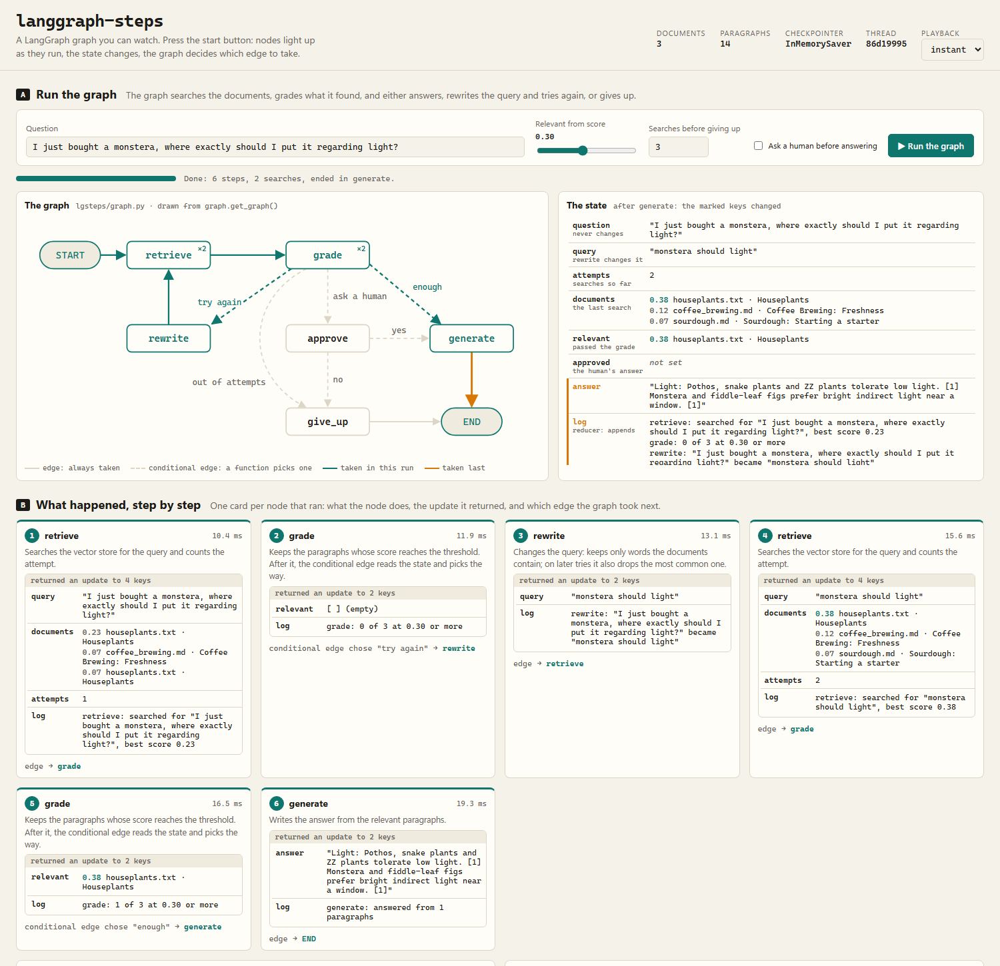

# langgraph-steps

A small LangGraph graph you can **watch**. One local page with a start button:
the nodes light up as they run, the state changes key by key, and you see which
edge the graph decided to take. It can also stop and wait for you.



It runs offline: the search and the answer are small stand-ins, so no API key
and no model download is needed. The graph, the state, the conditional edges,
the checkpoints and the interrupt are real LangGraph.

## Start it without a console

1. Get the folder: **[Download ZIP](../../archive/refs/heads/main.zip)** and unpack it (or `git clone`).
2. Double-click the starter:

| System | File | Notes |
| --- | --- | --- |
| Windows | `start.bat` | If Windows shows "Windows protected your PC": More info → Run anyway. |
| Linux | `start.desktop` or `start.sh` | Right-click → "Allow launching" / "Run as a program" (the wording depends on the desktop). |

The first start installs the Python packages into a `.venv` folder next to the
starter (a minute or two, needs internet). After that it starts at once and
opens <http://127.0.0.1:8767/> in your browser. Close the window to stop it.

The only thing that must already be on the computer is
[Python 3.10 or newer](https://www.python.org/downloads/) (on Windows tick
"Add python.exe to PATH" in the installer; on Debian/Ubuntu also `python3-venv`).

## Or from a console

```
pip install -r requirements.txt
python -m lgsteps                       # web interface, uvicorn started from inside
python -m lgsteps serve --port 9000 --no-open --folder my_notes
python -m lgsteps ask "which plants tolerate low light?"
```

## The graph

```
START → retrieve → grade ─┬─ "enough" ─────────→ generate → END
           ↑              ├─ "ask a human" ────→ approve ─┬─ "yes" → generate
           └── rewrite ←──┼─ "try again"                  └─ "no"  → give_up
                          └─ "out of attempts" → give_up → END
```

| Node | What it does |
| --- | --- |
| `retrieve` | searches the documents for the query, counts the attempt |
| `grade` | keeps the paragraphs whose score reaches the threshold |
| `rewrite` | changes the query (drops words the documents do not contain), then the graph loops back |
| `approve` | calls `interrupt()`: the run stops and waits for a human |
| `generate` | writes the answer from the relevant paragraphs |
| `give_up` | ends without an answer |

All of it is in `lgsteps/graph.py`, about 100 lines.

## What the page shows

| Part | LangGraph idea | What you see |
| --- | --- | --- |
| The graph | `StateGraph`, nodes, edges, conditional edges | drawn from `graph.get_graph()`; the running node is lit, taken edges are coloured, a counter shows loops |
| The state | one `TypedDict` shared by all nodes | every key after each step, the changed ones marked; `log` uses a reducer, so it grows instead of being replaced |
| Step cards | a node returns an update, not the whole state | one card per node run with the update it returned and the edge chosen after it |
| Approve / Reject | `interrupt()` and `Command(resume=...)` | tick "Ask a human before answering": the run pauses, your click resumes it from the checkpoint |
| Checkpoints | a checkpointer saves the state after every step | the list from `graph.get_state_history()` for the run's thread |

The page is fed by `graph.stream(..., stream_mode=["tasks", "updates", "values"])`,
LangGraph's own stream; nothing is instrumented by hand. Playback (instant /
normal / slow) only slows the display; the times shown are the real ones.

Questions to try (they are offered in the question box):

| Question | What happens |
| --- | --- |
| I just bought a monstera, where exactly should I put it regarding light? | one rewrite, then an answer |
| which plants tolerate low light? | answered at once |
| how do I change a flat car tyre? | gives up |
| when is my sourdough starter ready? | gives up at 0.30; move the slider to 0.25 and it answers |

## Files

```
lgsteps/graph.py     the LangGraph code: state, nodes, edges, interrupt
lgsteps/offline.py   the search index and the answer writer (offline stand-ins)
lgsteps/server.py    FastAPI app, streams newline-delimited JSON
lgsteps/webui/       index.html, app.js, style.css (plain JavaScript, no build step)
demo_data/           three short documents
tests/               python -m unittest discover tests   (needs: pip install httpx)
```

## The offline stand-ins, honestly

* The search counts word stems in 512 hashed buckets. It finds paragraphs that
  share words with the query, not paragraphs that share its meaning.
* `rewrite` is a rule, not a language model: it drops the words the documents
  do not contain.
* `generate` quotes the sentences that share the rarest words with the question.

In a real agent these three would call a model; the graph around them would
stay the same. Checkpoints are kept in memory (`InMemorySaver`) and are gone
when the server stops. Built with LangGraph 1.2.

See also: [rag-sqlite](https://github.com/hclivess/rag-sqlite), the same kind of page for plain RAG without a framework.

MIT licence.
